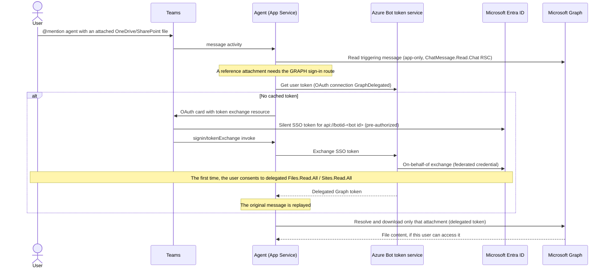

# ADR-001: Microsoft Graph access model for files shared in Teams chats

| Field | Value |
| --- | --- |
| Status | Accepted |
| Date | 2026-10-20 |
| Scope | How the Teams agent reads OneDrive and SharePoint files attached to personal and group chat messages |

## Context

The agent answers questions in Teams personal and group chats with a Microsoft
Foundry model. Users want to attach files and ask about them. Supported ways to
share a file include uploading from a device, attaching a cloud file, and
sharing from OneDrive or SharePoint.

This describes the access model, not support for every file or sharing-link
format. The bot host retrieves the bytes and passes them to a Foundry model
through the Responses API; it does not create a Foundry Agent Service agent,
give Foundry a Graph token, or configure a File Search index.

How Teams delivers these files determines which identity can read them:

- **Personal-chat uploads** arrive as a `file.download.info` attachment with a
  short-lived, pre-authenticated download URL. No Graph permission is needed.
- **Group-chat files and cloud attachments** arrive as a `reference`
  attachment. The file stays in the sender's OneDrive (the *Microsoft Teams
  Chat Files* folder) or on a SharePoint site. The agent must read it through
  Microsoft Graph
  ([Send and receive files with a bot](https://learn.microsoft.com/microsoftteams/platform/bots/how-to/bots-filesv4)).

The goal is to limit file access to the chat where the agent is used. The
platform doesn't directly support that:

- [Resource-specific consent (RSC)](https://learn.microsoft.com/microsoftteams/platform/graph-api/rsc/resource-specific-consent)
  scopes access to one chat or team. It covers chat messages, members, settings,
  and meetings, but it has **no file permission**. The agent already uses the
  RSC permission `ChatMessage.Read.Chat` to read the triggering group-chat
  message and recent history.
- A shared file's permissions belong to OneDrive or SharePoint, not to the
  chat. No Graph permission means "files in this chat".
- [Selected permissions](https://learn.microsoft.com/graph/permissions-selected-overview)
  (`Sites.Selected`, `Files.SelectedOperations.Selected`) need an
  explicit resource grant in addition to consent. A site grant can cover
  multiple files, but it is not a chat-scoped grant. For this demo, managing
  grants for ad hoc files in different users' OneDrives isn't practical.
- [`/shares/{encoded-url}`](https://learn.microsoft.com/graph/api/shares-get)
  would resolve sharing links directly, but it needs `Files.ReadWrite` (a write
  permission). Reading by drive path needs only `Files.Read.All` and, for
  SharePoint sites, `Sites.Read.All`.

So the real choice is **which kind of `Files.Read.All` and `Sites.Read.All`
permission** the agent uses. Microsoft Graph offers each as an *application*
permission and as a *delegated* permission
([delegated vs. application access](https://learn.microsoft.com/graph/auth/auth-concepts)).

## Decision drivers

1. **Blast radius.** Limit what a bug, a compromised host, or a leaked
   credential can read.
2. **Least privilege.** The agent shouldn't be able to read files the person
   asking couldn't read.
3. **Works in group chats**, not only personal chats.
4. **No secrets in the deployed environment.**
5. **Administrative burden.** Avoid privileged, tenant-wide grants for a proof
   of concept.
6. **User experience.** Keep sign-in and consent prompts to a minimum.
7. **Single-tenant.** All Microsoft Entra apps use `AzureADMyOrg`.

## Considered options

### Option 1: Application permissions (app-only)

Grant the agent's managed identity the Graph **application** permissions
`Files.Read.All` and `Sites.Read.All`. The agent reads every attachment with
its own app-only token.

The
[Microsoft Graph permissions reference](https://learn.microsoft.com/graph/permissions-reference)
describes application `Files.Read.All` as "Allows the app to read all files in
all site collections without a signed in user." Anything that obtains a token
for the identity can read:

- every user's OneDrive, including files never shared in Teams;
- every SharePoint site and document library in the organization;
- files in chats where the agent isn't installed.

Paths to misuse include:
- a defect in attachment, URL, or path handling;
- a compromised App Service or managed identity;
- a leaked local-debugging client secret;
- a future change that lets the model choose which files to read.

None of these is bounded by the chat, or by what the requesting user can see.
A user could also try to make the agent a *confused deputy*: share a reference
to a file the user can't open and let the agent read it with its own
permission.

**Pros**
- Simplest implementation: one credential and no sign-in.
- No user prompts; works the moment the app is installed.
- Works the same way in local debugging (with the local bot app).

**Cons**
- Organization-wide read access to all files and sites, with no user present.
- The code is the only control over which files are read; Graph enforces nothing
  user-specific.
- Exposed to confused-deputy requests unless the code is perfect.
- Requires tenant-wide administrator consent, typically by a Privileged Role
  Administrator or Global Administrator.
- Hard to justify to security reviewers, even in test tenants.

### Option 2: Delegated permissions with Teams SSO and on-behalf-of (OBO)

Read attachments with a **delegated** Graph token for the user who sent the
message. Teams
[single sign-on](https://learn.microsoft.com/microsoftteams/platform/bots/how-to/authentication/bot-sso-overview)
supplies the user's identity. The Azure Bot token service exchanges it through
the Microsoft Entra
[on-behalf-of flow](https://learn.microsoft.com/entra/identity-platform/v2-oauth2-on-behalf-of-flow),
configured with
[Agents SDK user authorization and a federated credential](https://learn.microsoft.com/microsoft-365/agents-sdk/azure-bot-user-authorization-federated-credentials).

**Pros**
- For delegated Graph calls, the user's own access is the ceiling: Graph
  refuses files outside that user's access. This avoids the app-only
  file-access confused deputy described above.
- The code narrows it further: only the triggering message's attachments are
  resolved, with the token of that message's sender.
- No organization-wide grant and no Graph application role assignment.
- No secrets: the token service and App Service authenticate as the sign-in app
  with
  [federated identity credentials](https://learn.microsoft.com/entra/workload-id/workload-identity-federation-config-app-trust-managed-identity).
- No privileged role is needed: an application administrator can grant consent
  for the delegated scopes. User self-consent works only where the tenant's
  consent policy allows these scopes (see *Admin consent for delegated scopes*).
- Follows the documented Teams pattern and Microsoft's
  [ProxyAgent-Python sample](https://github.com/OfficeDev/microsoft-365-agents-toolkit-samples/tree/dev/ProxyAgent-Python).

**Cons**
- More moving parts: a sign-in Entra app, an Azure Bot OAuth connection, two
  federated credentials, and Teams manifest `webApplicationInfo`.
- Each user must have a usable sign-in session. Consent is required only if
  the scopes haven't already been consented; tenant-wide delegated admin
  consent can satisfy that requirement.
- Delegated `Files.Read.All` and `Sites.Read.All` still cover everything *that
  user* can open, not only the attachment. The code limits use to the
  attachment.
- This repository's local debugging configuration doesn't provision Teams
  SSO, so its cloud-attachment flow must be tested in the deployed environment.
- Teams grants RSC to `webApplicationInfo.id`, which SSO requires to be the
  sign-in app. App-only RSC calls must therefore also authenticate as the
  sign-in app (through a managed-identity federated credential).

### Comparison

| Driver | Option 1: Application | Option 2: Delegated OBO |
| --- | --- | --- |
| Blast radius | Every file and site in the organization | Files the sending user can open |
| Least privilege | No; independent of the user | Yes; bounded by the user's access |
| Confused deputy | Prevented only by code | Prevented by Graph and code |
| Group chats | Yes | Yes |
| Deployed secrets | None (managed identity) | None (federated credentials) |
| Admin burden | Privileged tenant-wide admin consent | Delegated admin consent (non-privileged role) |
| User experience | No prompts | One sign-in per user |
| Local debugging | Works | Cloud attachments not available |
| Complexity | Low | Moderate |

## Decision

**Choose Option 2: delegated access with Teams SSO and on-behalf-of.**

The agent never holds the Graph application permissions `Files.Read.All` or
`Sites.Read.All`. Organization-wide read access with no user present is a blast
radius that a proof of concept can't justify. It also makes the agent a
potential confused deputy. Option 2 limits access to what the requesting user
can already open, and to the attachments on that user's message. The added
complexity and the one-time sign-in are acceptable costs.

Supporting decisions:

- **Admin consent for delegated scopes.** Microsoft's managed
  [user-consent policy](https://learn.microsoft.com/entra/identity/enterprise-apps/configure-user-consent)
  (`microsoft-user-default-recommended`) excludes `Files.Read.All` and
  `Sites.Read.All` from user consent, even when delegated. In such tenants,
  users see **Need admin approval** and the token exchange returns
  `Consent Required`. An application administrator grants tenant-wide consent
  for the sign-in app's *delegated* scopes
  (`az ad app permission admin-consent --id <SSO_APP_ID>`). This adds no
  application permission; tokens remain limited to each user's own access.
- **Personal installation.** Teams SSO in a group chat requires the app to be
  installed for personal use by the user who signs in. Otherwise Teams privately
  prompts that user to add the app before the sign-in card works.
- **Deployed only.** Local Teams debugging doesn't provision SSO. It reports
  that sign-in isn't configured instead of falling back to an application
  permission.
- **No application fallback.** If no user token is available, the attachment is
  skipped with an explanation.
- **Personal-chat uploads** continue to use the Teams pre-authenticated URL.
- **Single-tenant** apps only. The *AAD v2 with Federated Credentials* OAuth
  connection type also requires this.

## Consequences

### Positive

- Delegated Graph file reads are bounded by the signed-in user's access,
  unlike tenant-wide application file permissions.
- No identity in the solution holds Graph application file permissions.
- The deployed runtime needs no client secret or tenant-wide Graph application
  file role. Deployment still requires Azure resource permissions, Entra app
  creation permissions, and a Foundry RBAC assignment. Delegated admin consent
  can be granted by an application administrator.

### Negative

- Users see a **Sign in to share files** card the first time they share a cloud
  file. In group chats the card is posted to the conversation; each token
  belongs to whoever signs in and is used only to replay that user's pending
  message.
- OneDrive and SharePoint attachments must be tested in the deployed
  environment.
- The Teams app must be installed with the correct `webApplicationInfo`. Any
  change to it requires updating the app in each chat and approving
  `ChatMessage.Read.Chat` again.
- Some tenants enforce an app management policy that blocks custom `api://`
  identifier URIs, which would block creating the sign-in app.

### Residual risk

- Delegated `*.Read.All` scopes cover every file the signed-in user can open.
  A code defect could read other files accessible to that user. This is a
  per-token authorization boundary, not a guarantee against host compromise:
  a compromised host could misuse tokens for other signed-in users, chat RSC
  access, and pre-authenticated URLs available to it.
- File access is checked for the sender, not separately for every group-chat
  participant. The bot's answer is visible to the conversation; ensure the
  attachment is appropriate for that audience.
- The Azure Bot token service caches user tokens. Users can revoke consent at
  [My Apps](https://myapps.microsoft.com); administrators can remove grants
  under
  [Enterprise applications](https://learn.microsoft.com/entra/identity/enterprise-apps/manage-application-permissions).
- File content is sent to the Foundry model. Use non-sensitive data while
  testing. The bot doesn't write file bytes to durable local storage, but this
  is not a zero-retention guarantee for Foundry. The Responses call doesn't
  explicitly set `store=False`; review service retention and logging policies.

### Demo support boundaries

- Only attachments on the triggering message are processed, not files on
  earlier messages or URLs typed into message text.
- Supported types are PDF, PNG, JPEG, WebP, and non-animated GIF, with a default
  20 MiB per-file limit. Office and text files are unsupported.
- URLs must use the configured tenant's `<tenant>.sharepoint.com` or
  `<tenant>-my.sharepoint.com` host. An empty tenant prefix rejects these URLs.
- Cloud references must have a supported direct path. The resolver doesn't
  redeem arbitrary sharing links through `/shares`.
- OneDrive references are resolved against `/users/{sender-id}/drive`, not
  against an owner discovered from the URL. Use files in the sender's own
  OneDrive for the demo; a reference to another person's OneDrive isn't
  generally supported even if the sender can open it.
- SharePoint references use `/sites/...` or `/teams/...` paths and match the
  document-library segment to Graph drive names.
- Channels are ignored. Bot file-consent uploads are personal-chat only;
  group-chat replies provide existing file locations instead.

## Implementation

### Flow



### Components

The triggering group-chat message is fetched without `$expand`: the
[Get chatMessage API](https://learn.microsoft.com/graph/api/chatmessage-get)
does not support OData query parameters and includes file `attachments` in its
normal response. When the message body references inline hosted content, the
agent lists it through the message's separate `/hostedContents` endpoint using
the same chat-scoped application credential. OneDrive/SharePoint downloads still
require the sending user's delegated token.

| Component | Where | Purpose |
| --- | --- | --- |
| Sign-in Entra app (`<resourceBaseName>-userauth`) | [`infra/userAuth/userAuthApp.bicep`](../infra/userAuth/userAuthApp.bicep) | Single-tenant app. Exposes `api://botid-<bot id>/access_as_user`, pre-authorized for the Teams clients. Requests only delegated Graph scopes: `openid`, `profile`, `offline_access`, `Files.Read.All`, and `Sites.Read.All`. |
| Federated credential: Bot token service | Same file | Lets the Azure Bot token service authenticate as the sign-in app for the OBO exchange. |
| Federated credential: managed identity | Same file | Lets the App Service managed identity authenticate as the sign-in app for app-only RSC calls (`GRAPH_AUTH_MODE=federated`). |
| OAuth connection `GraphDelegated` | [`infra/botRegistration/azurebot.bicep`](../infra/botRegistration/azurebot.bicep) | *AAD v2 with Federated Credentials* connection with the token exchange URL `api://botid-<bot id>`. |
| Teams manifest | [`appPackage/manifest.json`](../appPackage/manifest.json) | `webApplicationInfo` points to the sign-in app and its SSO resource. `validDomains` includes `token.botframework.com`. |
| GRAPH user-authorization handler | App setting `AGENTAPPLICATION__USERAUTHORIZATION__HANDLERS__GRAPH__SETTINGS__AZUREBOTOAUTHCONNECTIONNAME` | Enables sign-in in the Agents SDK. |
| Sign-in routes | [`src/agent.py`](../src/agent.py) | Requests a token only when the message, or a file-consent export, involves a OneDrive or SharePoint item. |
| Token use | [`src/files.py`](../src/files.py) | Uses the delegated token for every OneDrive or SharePoint call, with no application fallback. |
| Local bot app | [`aad.manifest.json`](../aad.manifest.json) | `requiredResourceAccess: []`: no Graph file permissions. |

### Identity per call

| Call | Identity | Scope of access |
| --- | --- | --- |
| Teams → agent, replies, inline images in personal chats | Bot managed identity (Bot Connector) | Azure Bot registration |
| Triggering group-chat message, inline images, history | Sign-in app, app-only (local: bot app secret) | `ChatMessage.Read.Chat` RSC for that chat only |
| OneDrive/SharePoint attachment | Sending user's delegated token | Files that user can open; only the attachment on that message |
| Personal-chat upload | Pre-authenticated Teams URL | One file |
| Foundry | Bot managed identity | Foundry RBAC |

## Compliance checks

### No application file permissions

No identity in this solution should hold the Graph application roles
`Files.Read.All` (`01d4889c-1287-42c6-ac1f-5d1e02578ef6`) or `Sites.Read.All`
(`332a536c-c7ef-4017-ab91-336970924f0d`). Check the bot managed identity
(`BOT_ID` in `env/.env.dev`) and the local bot app (`BOT_ID` in
`env/.env.local`), as well as the sign-in app (`SSO_APP_ID` in
`env/.env.dev`). Repeat the check below for each identity's client ID.
If any has one, remove it with the
[delete appRoleAssignment API](https://learn.microsoft.com/graph/api/serviceprincipal-delete-approleassignments):

```bash
SP_ID=$(az ad sp show --id "<BOT_ID>" --query id -o tsv)

az rest --method GET \
  --url "https://graph.microsoft.com/v1.0/servicePrincipals/$SP_ID/appRoleAssignments" \
  --query "value[?appRoleId=='01d4889c-1287-42c6-ac1f-5d1e02578ef6' || appRoleId=='332a536c-c7ef-4017-ab91-336970924f0d'].{id:id, role:appRoleId}" \
  -o table

az rest --method DELETE \
  --url "https://graph.microsoft.com/v1.0/servicePrincipals/$SP_ID/appRoleAssignments/<assignment-id>"
```

You can also open **Microsoft Entra admin center** > **Enterprise
applications**, select the identity, open **Permissions**, and revoke any
Microsoft Graph application permissions. The automated tests in
[`tests/test_manifest.py`](../tests/test_manifest.py) also fail if the Bicep
templates or the Entra manifest request Graph application roles.

### Verify the deployment

1. Confirm that the `<resourceBaseName>-userauth` app lists only *delegated*
   Graph permissions and has two federated credentials.
2. On the Azure Bot resource, open **Configuration** > **OAuth Connection
   Settings** > `GraphDelegated` and run **Test Connection**.
3. Install the Teams app and approve `ChatMessage.Read.Chat` in each test group
   chat.
4. Mention the agent with a OneDrive or SharePoint file attached and sign in
   once. The agent should read the file. Ask a different user to share a file
   they can't access, and confirm that it's reported as not readable.

## References

- [Resource-specific consent for Teams apps](https://learn.microsoft.com/microsoftteams/platform/graph-api/rsc/resource-specific-consent)
- [Microsoft Graph permissions reference](https://learn.microsoft.com/graph/permissions-reference)
- [Microsoft Graph authentication and authorization basics](https://learn.microsoft.com/graph/auth/auth-concepts) (delegated vs. application access)
- [Overview of selected permissions in OneDrive and SharePoint](https://learn.microsoft.com/graph/permissions-selected-overview)
- [Access shared items (`/shares`)](https://learn.microsoft.com/graph/api/shares-get)
- [Send and receive files with a bot](https://learn.microsoft.com/microsoftteams/platform/bots/how-to/bots-filesv4)
- [Enable SSO for your bot app](https://learn.microsoft.com/microsoftteams/platform/bots/how-to/authentication/bot-sso-overview)
- [Register your bot app in Microsoft Entra ID for SSO](https://learn.microsoft.com/microsoftteams/platform/bots/how-to/authentication/bot-sso-register-aad)
- [Add code to enable bot SSO](https://learn.microsoft.com/microsoftteams/platform/bots/how-to/authentication/bot-sso-code)
- [Add user authorization using a federated identity credential (Agents SDK)](https://learn.microsoft.com/microsoft-365/agents-sdk/azure-bot-user-authorization-federated-credentials)
- [Single sign-on in Azure AI Bot Service](https://learn.microsoft.com/azure/bot-service/bot-builder-concept-sso)
- [Microsoft identity platform on-behalf-of flow](https://learn.microsoft.com/entra/identity-platform/v2-oauth2-on-behalf-of-flow)
- [Configure an app to trust a managed identity](https://learn.microsoft.com/entra/workload-id/workload-identity-federation-config-app-trust-managed-identity)
- [Microsoft Graph Bicep: applications](https://learn.microsoft.com/graph/templates/bicep/reference/applications)
- [Permissions and consent overview](https://learn.microsoft.com/entra/identity-platform/permissions-consent-overview)
- [Application consent experience](https://learn.microsoft.com/entra/identity-platform/application-consent-experience)
- [Configure user consent](https://learn.microsoft.com/entra/identity/enterprise-apps/configure-user-consent)
- [Review and revoke application permissions](https://learn.microsoft.com/entra/identity/enterprise-apps/manage-application-permissions)
- [Delete an appRoleAssignment](https://learn.microsoft.com/graph/api/serviceprincipal-delete-approleassignments)
- [ProxyAgent-Python sample (Teams SSO + federated OAuth connection)](https://github.com/OfficeDev/microsoft-365-agents-toolkit-samples/tree/dev/ProxyAgent-Python)
