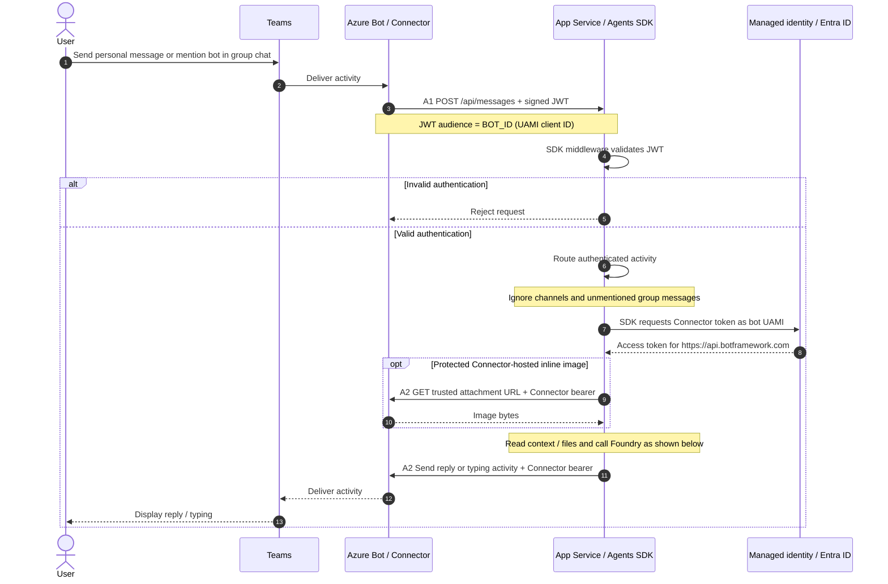
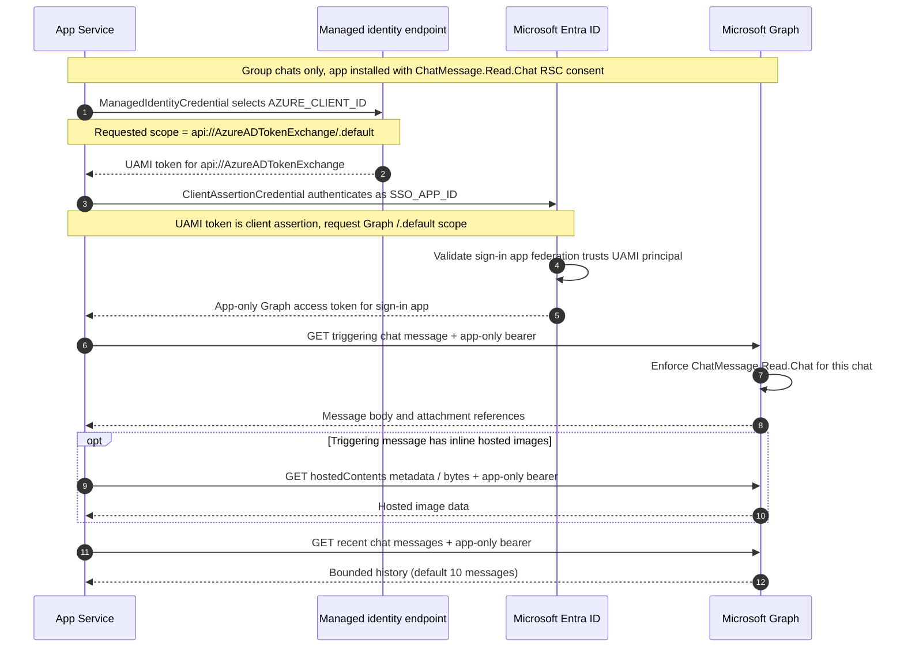
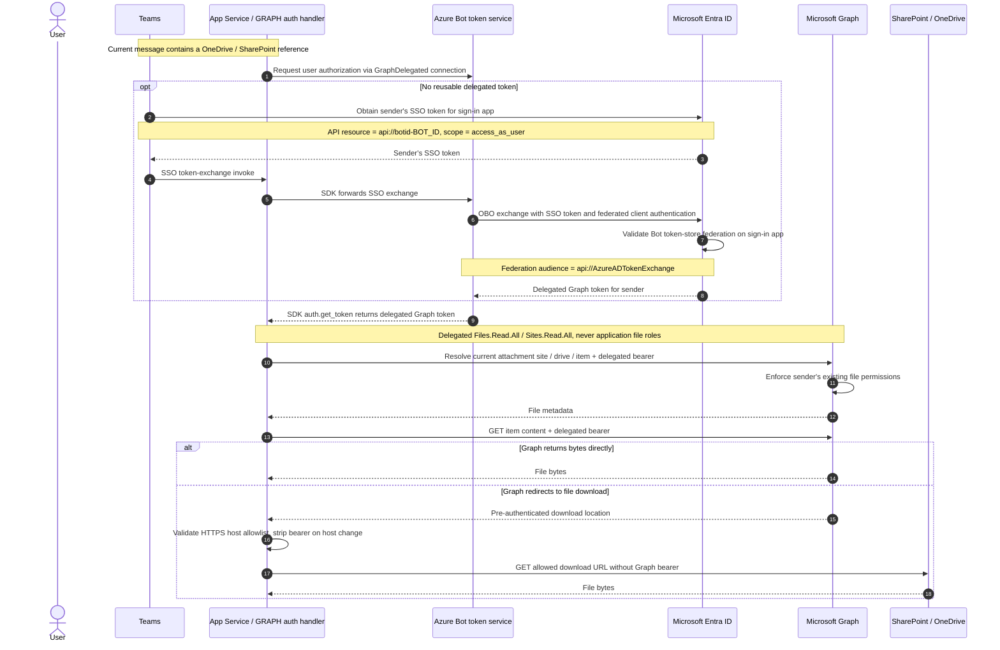
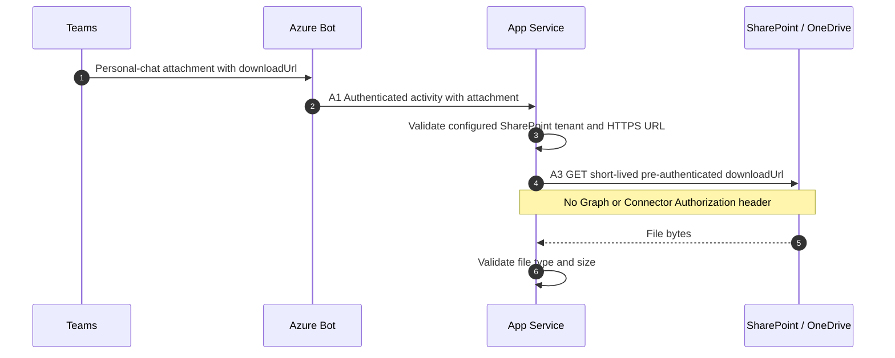
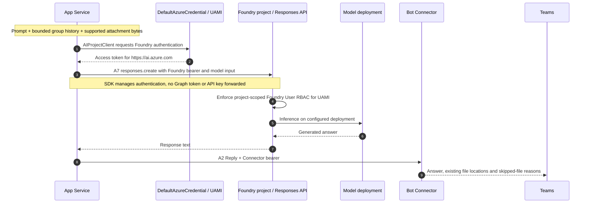
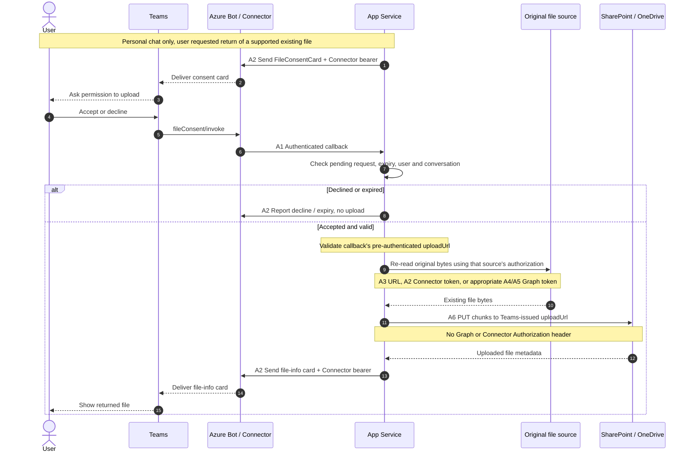

# Token workflow sequence diagrams

These Mermaid sequence diagrams describe the deployed implementation, not a live
Azure trace. A1-A7 match the [README authentication table](../README.md#authentication-flow).
View them on GitHub or in a Mermaid-enabled Markdown preview.

The user-assigned managed identity (UAMI) is the bot identity. The separate
single-tenant sign-in app (`SSO_APP_ID`) handles Teams SSO and holds the
chat-scoped Graph grants. Tokens for Connector, Graph, and Foundry are not
interchangeable; a `/.default` scope request is not the JWT audience itself.
Acquisition steps below run when a suitable cached token is unavailable.

## A1-A2: Incoming activities and Bot Connector authentication

The inbound Bot Framework JWT authenticates the activity; it is **not** a
delegated token for the sender's Graph files.

## A4: App-only Graph tokens for chat-scoped reads

Teams grants RSC to `webApplicationInfo.id = SSO_APP_ID`, not directly to the
deployed UAMI. This path grants chat-message access, **not** OneDrive/SharePoint
file access. Personal chats do not request Graph history.

## A5: Teams SSO and delegated Graph file access

The connection requests `openid profile offline_access Files.Read.All Sites.Read.All`.
Consent is required according to tenant policy; the user must sign in and have
the app installed for personal use. The SDK can prompt for sign-in when silent
SSO is unavailable. Failed sign-in means files are not read; there is no
app-only file fallback.

Graph limits access to what the sender can open. The **application code**
further limits requests to current-message attachments; the delegated scopes
themselves are broader. OneDrive lookup assumes the sender's own drive.

## A3: Personal-chat files through pre-authenticated download URLs

The URL is a credential by possession, not an anonymous public file link.
Do not log or share it. Supported inputs are PDF, PNG, JPEG, WebP, and
non-animated GIF, with a default 20 MiB limit per file. These file checks also
apply to Connector and Graph downloads. Unsupported or unreadable files are
reported as skipped; typed URLs and historical attachments are not fetched.

## A7: Foundry inference and the reply

Foundry authentication is independent of `GRAPH_AUTH_MODE`. PDF/image bytes
are encoded into the model request by the bot; the model does not fetch files.
Replies in group chats are visible to participants: sender access does not
prove every recipient has access to the source file. File bytes are handled
in memory; this POC does not establish a Foundry zero-retention guarantee.

## A6: Returning an existing file after personal-chat consent

File-return consent does not grant Graph access to the original source; the
source must still be readable when fetched again. Group chats receive existing
file locations instead of bot-uploaded files.

## Local-debugging differences

| Path | Local Teams debugging |
| --- | --- |
| A1 inbound | Same SDK JWT validation path. |
| A2 Connector | Generated local bot app and Git-ignored client secret instead of UAMI. |
| A4 chat Graph | `ClientSecretCredential` for the local bot app, which is also the local `webApplicationInfo.id`; per-chat RSC still required. |
| A5 cloud-file references | Not provisioned locally; skipped without delegated authorization, never read app-only. |
| A3/A6 file URLs | Same pre-authenticated URL mechanism, subject to tenant/host checks and personal-chat consent for upload. |
| A7 Foundry | Developer's Azure CLI / VS Code credential, with Foundry RBAC. |

Agents Playground simulates personal-chat handling but does not establish real
Teams SSO or chat RSC consent; inference still calls the live Foundry model.

Sources: [HTTP authentication](../src/app.py),
[runtime credentials and routing](../src/agent.py),
[file operations](../src/files.py), [Graph and inference clients](../src/foundry.py),
[sign-in app federation](../infra/userAuth/userAuthApp.bicep),
and [Azure Bot OAuth connection](../infra/botRegistration/azurebot.bicep).
